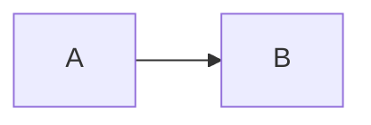

# Café Türkçe 日本語 😀
# Duplicate
# Duplicate

Setext heading
--------------

*Emphasis* **strong** ~~strike~~ `inline` [reference][ref] <https://example.com>

1. Ordered
   - Nested
     > Normal quote
2. Another item

A footnote[^one].

[^one]: A useful footnote with **formatting**.

More information

<kbd>⌘</kbd> H2O and x2

[ref]: https://example.com
