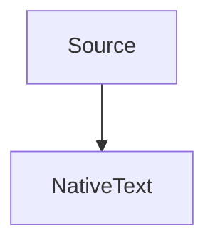

# Language and theme verification

This original, anonymous fixture exercises every shipped language and alias. It contains no private source. Code is illustrative reader content; opening this document must never execute it.

## Theme families

Choose each palette in Settings → Code and verify comments, keywords, strings, numbers, types, and attributes remain legible. Theme changes recolor cached tokens. With automatic pairing enabled, GitHub, VS Code, and Xcode families follow the app's light/dark appearance; the standalone dark palettes retain their identity.

| Family | Palette identifiers |
| --- | --- |
| One Dark | `one-dark` |
| Night Owl | `night-owl` |
| Darcula | `darcula` |
| GitHub | `github-light`, `github-dark` |
| VS Code Light+ / Dark+ | `vscode-light-plus`, `vscode-dark-plus` |
| Xcode-inspired | `xcode-light`, `xcode-dark` |

These are original MarkUp palettes inspired by the named families, without official affiliation.

## Swift

```swift
import SwiftUI

@MainActor @Observable
final class ReadingModel<Element: Identifiable & Sendable> {
    @ObservationIgnored private var task: Task<Void, Never>?
    var entries: [Element] = []
    let literal = #"Preserve \n and \"quotes\""#
    let multiline = """
        A multiline string with interpolation: \(2 + 3)
        """
    /* An outer comment /* with a nested comment */ remains a comment. */
    func first<T: Sequence>(_ values: T) -> T.Element? { values.first { _ in true } }
}
```

## Bash / shell

```bash
#!/usr/bin/env bash
# A quoted path stays data.
folder="docs with spaces"
for item in "$folder"/*.md; do
  printf '%s\n' "$item"
done
```

## JSON

```json
{"reader": "MarkUp", "enabled": true, "items": [1, 2.5, null], "unicode": "日本語 😀"}
```

## YAML

```yaml
reader: MarkUp
features:
  - native text
  - annotations
enabled: true
message: |
  A literal block preserves line breaks.
```

## TOML

```toml
[reader]
name = "MarkUp"
font_size = 16
features = ["tables", "code"]
```

## JavaScript

```javascript
// Keep template interpolation and regular expressions distinct.
export async function titleFor(document) {
  const pattern = /^readme\.(md|markdown)$/i;
  return `${document.title ?? "Untitled"}: ${pattern.test(document.name)}`;
}
```

## TypeScript

```typescript
interface Entry<T> { readonly id: string; value: T }
export function unwrap<T>(entry: Entry<T> | null): T | undefined {
  return entry?.value;
}
```

## JSX

```jsx
export const ReadingCard = ({ title, children }) => (
  <section aria-label={title}>
    <h2>{title}</h2>
    {children}
  </section>
);
```

## TSX

```tsx
type Props = { title: string; selected?: boolean };
export function ReadingCard({ title, selected = false }: Props) {
  return <button aria-pressed={selected}>{title}</button>;
}
```

## Python

```python
from dataclasses import dataclass

@dataclass(frozen=True)
class Entry:
    title: str
    count: int = 1

async def summarize(items: list[Entry]) -> str:
    return ", ".join(f"{item.title}: {item.count}" for item in items)
```

## HTML

```html
<article lang="en">
  <!-- Source is displayed, never executed. -->
  <h1 data-kind="reader">MarkUp &amp; native text</h1>
  
</article>
```

## XML

```xml
<?xml version="1.0" encoding="UTF-8"?>
<reader version="1"><title>MarkUp</title><enabled>true</enabled></reader>
```

## CSS

```css
:root { --reading-width: 54rem; }
.reader[data-appearance="dark"] {
  color: #d4d4d4;
  max-width: var(--reading-width);
  padding: 1.5rem;
}
```

## SQL

```sql
-- Reader content only: this query is not executed.
SELECT title, COUNT(*) AS occurrences
FROM reading_entries
WHERE created_at >= '2026-01-01'
GROUP BY title
ORDER BY occurrences DESC;
```

## C

```c
#include <stddef.h>
/* Sum positive sample values. */
int sum(const int *values, size_t count) {
    int result = 0;
    for (size_t i = 0; i < count; ++i) result += values[i];
    return result;
}
```

## C++

```cpp
#include <optional>
#include <string>
template <typename T>
struct Entry { std::string title; std::optional<T> value; };
auto sample = Entry<int>{"MarkUp", 42};
```

## Objective-C

```objectivec
#import <Foundation/Foundation.h>
@interface ReadingEntry : NSObject
@property(nonatomic, copy) NSString *title;
@end
@implementation ReadingEntry
- (NSString *)description { return [NSString stringWithFormat:@"Entry: %@", self.title]; }
@end
```

## C#

```csharp
public record ReadingEntry(string Title, int Count);
var entries = new[] { new ReadingEntry("MarkUp", 1) };
var selected = entries.Where(entry => entry.Count > 0).ToList();
```

## Java

```java
import java.util.List;
public record ReadingEntry(String title, int count) {
    public static List<String> titles(List<ReadingEntry> entries) {
        return entries.stream().map(ReadingEntry::title).toList();
    }
}
```

## Kotlin

```kotlin
data class ReadingEntry(val title: String, val count: Int = 1)
suspend fun titles(entries: List<ReadingEntry>): List<String> =
    entries.filter { it.count > 0 }.map { "Title: ${it.title}" }
```

## Go

```go
package reader
import "fmt"
type Entry struct { Title string; Count int }
func (entry Entry) String() string {
    return fmt.Sprintf("%s: %d", entry.Title, entry.Count)
}
```

## Rust

```rust
#[derive(Debug, Clone)]
struct Entry<'a> { title: &'a str, count: usize }
fn titles(entries: &[Entry<'_>]) -> Vec<&str> {
    entries.iter().filter(|entry| entry.count > 0).map(|entry| entry.title).collect()
}
```

## Markdown source

````markdown
# A source heading

> [!NOTE]
> A source alert remains code inside this fence.

- [x] A task
- **Emphasis** and [a link](https://example.org)

```swift
let nestedFence = true
```
````

## Diff

```diff
--- a/reader.txt
+++ b/reader.txt
@@ -1,2 +1,2 @@
-Old sample title
+Native reading sample
 Unchanged content
```

## Plain text and unknown identifiers

```plaintext
Unstyled source stays exact: <xml> & "quotes" \ backslash 日本語 😀
```

```unknown-language
This identifier has no grammar. Preserve all source and do not fail.
```



Mermaid rendering is deferred. Its source remains readable and copyable.

## Alias coverage

Each following fence exercises an alias accepted by the bundled tokenizer. The uppercase spelling verifies case normalization.

### `SWIFT` → `swift`

```SWIFT
let alias = "Swift"
```

### `sh` → `bash`

```sh
printf "%s\n" "$HOME"
```

### `shell` → `bash`

```shell
printf "%s\n" "$HOME"
```

### `zsh` → `bash`

```zsh
printf "%s\n" "$HOME"
```

### `shellscript` → `bash`

```shellscript
printf "%s\n" "$HOME"
```

### `jsonc` → `json`

```jsonc
{"alias": true}
```

### `yml` → `yaml`

```yml
alias: true
```

### `ini` → `toml`

```ini
alias = true
```

### `js` → `javascript`

```js
const alias = `JavaScript ${1 + 2}`;
```

### `mjs` → `javascript`

```mjs
const alias = `JavaScript ${1 + 2}`;
```

### `cjs` → `javascript`

```cjs
const alias = `JavaScript ${1 + 2}`;
```

### `ts` → `typescript`

```ts
const alias: string = "TypeScript";
```

### `mts` → `typescript`

```mts
const alias: string = "TypeScript";
```

### `cts` → `typescript`

```cts
const alias: string = "TypeScript";
```

### `py` → `python`

```py
alias = f"Python {1 + 2}"
```

### `xhtml` → `html`

```xhtml
<reader enabled="true">XML alias</reader>
```

### `svg` → `html`

```svg
<reader enabled="true">XML alias</reader>
```

### `h` → `c`

```h
const int alias = 42;
```

### `c++` → `cpp`

```c++
template <typename T> struct Alias { T value; };
```

### `cc` → `cpp`

```cc
template <typename T> struct Alias { T value; };
```

### `cxx` → `cpp`

```cxx
template <typename T> struct Alias { T value; };
```

### `hpp` → `cpp`

```hpp
template <typename T> struct Alias { T value; };
```

### `h++` → `cpp`

```h++
template <typename T> struct Alias { T value; };
```

### `objective-c` → `objectivec`

```objective-c
NSString *alias = @"Objective-C";
```

### `objc` → `objectivec`

```objc
NSString *alias = @"Objective-C";
```

### `mm` → `objectivec`

```mm
NSString *alias = @"Objective-C";
```

### `c#` → `csharp`

```c#
var alias = new { Title = "C#" };
```

### `cs` → `csharp`

```cs
var alias = new { Title = "C#" };
```

### `kt` → `kotlin`

```kt
val alias: String = "Kotlin"
```

### `kts` → `kotlin`

```kts
val alias: String = "Kotlin"
```

### `golang` → `go`

```golang
alias := "Go"
```

### `rs` → `rust`

```rs
let alias: &str = "Rust";
```

### `md` → `markdown`

```md
## **Markdown** alias
```

### `patch` → `diff`

```patch
+added alias
-removed alias
```

LANGUAGE-THEME-FIXTURE-END
